<h1 align="center">JobMagnet</h1>

<p align="center"><b>A CV rewritten for every job, from your real experience only.<br>Plus fresh jobs ranked for you, interview prep, cold emails and a career map.</b></p>

<p align="center">
  <a href="https://github.com/pixar634/jobmagnet/actions/workflows/ci.yml"></a>
  <a href="LICENSE"></a>
  
  <a href="CONTRIBUTING.md"></a>
</p>

<p align="center">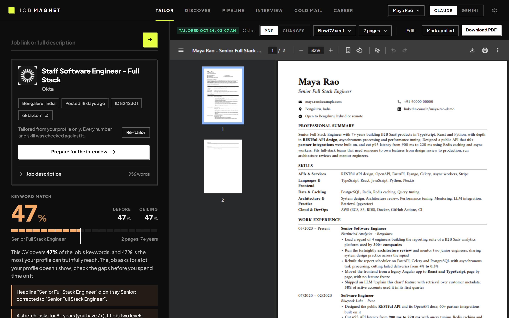</p>

You find a role you'd be great at, spend an evening rewording your CV, guess at the keywords, export a PDF, and hear
nothing back. An applicant tracking system (ATS) read it before any person did, and it didn't see what the job asked for.

**JobMagnet fixes that in one paste.** Drop in a job link and you get a CV rewritten for that exact role. It's checked
line by line the way an ATS reads it, scored before and after, and comes with a cover letter. It's written **only from
your real experience**: code checks every number and skill against your profile, so every line holds up in the interview.

It runs on your own computer. Your CV and applications stay there. The writing is done by **Claude or Gemini**, through
the command-line tools you sign in to (or an API key you provide).

> Every screenshot in this README shows **Maya Rao, an invented person** with invented employers. The job postings
> are real public listings.

---

## Contents

- [What it does](#-what-it-does)
- [How it works](#-how-it-works)
- [Quick start](#-quick-start)
- [Choose your AI writer](#-choose-your-ai-writer): Claude or Gemini, signed in or with an API key
- [A tour of the app](#%EF%B8%8F-a-tour-of-the-app)
- [What it will never do](#%EF%B8%8F-what-it-will-never-do)
- [Where jobs come from](#-where-jobs-come-from)
- [Troubleshooting](#-troubleshooting)
- [Project layout](#-project-layout)
- [Contributing](#-contributing), [Security](#-security), [License](#-license)

---

## ✨ What it does

| Screen | What you get |
|---|---|
| **Setup** | Drop in your CV. It becomes your master profile, checked against the CV's own text, plus a search strategy: your level, the roles to aim for, the employers and searches worth watching. |
| **Tailor** | Paste a job link or description. Get a tailored CV as a PDF in 1 to 3 minutes, with the keyword match before, after and at the ceiling your profile can truthfully reach. |
| **Discover** | Fresh jobs from employers' job boards and web searches, ranked against your profile. Mark one **Not for me** and it learns what to push down. |
| **Pipeline** | Every application on one board, from Tailoring to Applied to Offer. Export to Excel. |
| **Interview** | Company research, three rounds of questions with model answers from your real experience, and an adaptive coding test for coding roles. |
| **Cold mail** | A short email and its follow-up to a hiring manager or recruiter, saved to your Gmail drafts. Never sent for you. |
| **Career** | Your history as a map and five or six researched routes for the next five years, with a goal, a salary log and a growth log. |
| **Chrome extension** | Tailor from the job page you're on, then fill the application form for you to review and submit. |

---

## 🧠 How it works

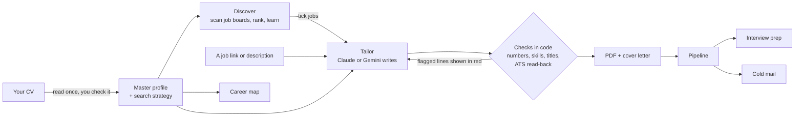

1. **Your CV becomes a master profile**: every role, bullet, number and skill, which you review before anything uses it.
2. **A strategy is worked out from it**: your field and level, the kinds of role you can honestly aim for, the job
   titles recruiters use for them, and the employers and searches worth watching.
3. **For each job**, the writer gets a brief with the job description, your profile and the strategy, and returns a
   plan: headline, summary, skills and bullets.
4. **Code checks the plan before anything is printed.** A number, skill or title that isn't in your profile is removed
   or flagged in red. Your titles, companies and dates are printed by code, never written by the AI.
5. **The PDF is printed and read back** the way an ATS reads it, and the keyword match is computed by code, so the
   same job always gets the same score.

---

## 🚀 Quick start

### You need

| | What | Why |
|---|---|---|
| ✅ | **Python 3.12** ([download](https://www.python.org/downloads/)). On Windows, tick *Add python.exe to PATH* | Runs the app |
| ✅ | **Google Chrome** | Prints the PDFs, and runs the optional extension |
| ✅ | **Claude Code** or **Gemini CLI**, signed in or with an API key | Does the writing: see [Choose your AI writer](#-choose-your-ai-writer) |
| ➕ | **Node.js 18+** ([download](https://nodejs.org)) | Only to install the Gemini CLI, or Claude Code through npm |

### Install and run

**Windows**

```powershell
git clone https://github.com/pixar634/jobmagnet.git C:\jobmagnet
cd C:\jobmagnet
.\start.bat
```

`start.bat` creates a virtual environment, installs everything the first time, and opens
http://127.0.0.1:8765. Next time, just double-click `start.bat`. Keep its window open while you work; closing it stops
the app. Clone to a short folder like `C:\jobmagnet`: Windows limits file paths to 260 characters.

**macOS and Linux**

```bash
git clone https://github.com/pixar634/jobmagnet.git ~/jobmagnet
cd ~/jobmagnet
python3.12 -m venv .venv
source .venv/bin/activate
pip install -r requirements.txt
python -m uvicorn app.main:app --port 8765
```

Then open http://127.0.0.1:8765. Next time: `cd ~/jobmagnet && source .venv/bin/activate && python -m uvicorn app.main:app --port 8765`.

### First run

1. **Drop in your CV** (PDF or Word) or paste its text. Optionally say what you want next.
2. **Wait 2 to 4 minutes** while it reads the CV and researches your market.
3. **Check what it read** and fix anything wrong. Then press **Looks right, open the app**.
4. **Paste a job link** in Tailor and press Enter.

To update later: `git pull`, then start the app again.

### The Chrome extension (optional)

1. Open `chrome://extensions` and switch on **Developer mode** (top right).
2. Click **Load unpacked** and pick the `extension` folder inside JobMagnet.
3. Pin the magnet icon. The first time you use it, it asks to read the job pages you open. It only talks to the app on
   your own computer, so keep the app running.

---

## 🤖 Choose your AI writer

JobMagnet doesn't call an AI API itself. It runs **Claude Code** (`claude`) or the **Gemini CLI** (`gemini`) on your
computer, in an empty folder with no file access, and reads back the text. So you can use either one, signed in with a
subscription or with an API key, and switch between them from the top bar.

<p align="center">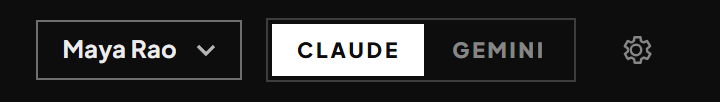</p>

### What each writer can do

| Feature | Claude | Gemini |
|---|:---:|:---:|
| Reading your CV, tailoring, cover letters, interview questions, cold email text, career map | ✅ | ✅ |
| Web research while setting up your strategy and career map | ✅ | Runs without it |
| Discover web searches, Indeed scans, people to watch, finding contacts, company research for interviews | ✅ | Uses Claude |
| Saving cold emails to Gmail drafts | ✅ with a claude.ai sign-in | Uses Claude |

Claude gives the fullest experience. With only Gemini set up, everything that writes works, and the research features
ask for Claude.

### Option 1: Claude

**Install Claude Code**, Anthropic's command-line tool. Pick one:

```bash
# macOS / Linux
curl -fsSL https://claude.ai/install.sh | bash
```

```powershell
# Windows (PowerShell)
irm https://claude.ai/install.ps1 | iex
```

```bash
# Or with Node.js, on any system
npm install -g @anthropic-ai/claude-code
```

Check it's installed: `claude --version`. Keep it current with `claude update`.

**Then connect it, one of two ways:**

<details open>
<summary><b>A. Sign in with a Claude subscription</b> (Pro or Max). Usage comes out of your plan; there's no separate bill.</summary>

1. Open a terminal and run `claude`.
2. Choose **Claude account with subscription** and finish signing in in the browser window it opens.
3. Type `/exit`. That's it: JobMagnet now uses that sign-in.

Signing in this way also unlocks the claude.ai connectors JobMagnet can use: **Gmail** (to save cold-email drafts)
and **Indeed** (for Scan Indeed). Turn them on at [claude.ai](https://claude.ai) → Settings → Connectors.
</details>

<details>
<summary><b>B. Use an API key</b>. You pay per use on your Anthropic account.</summary>

1. Create a key at [console.anthropic.com](https://console.anthropic.com/settings/keys) (Settings → API keys). It starts with `sk-ant-`.
2. Make it available to the app:

   **Windows** (run once in PowerShell, then close and reopen any terminal, and run `start.bat` again):
   ```powershell
   setx ANTHROPIC_API_KEY "sk-ant-your-key-here"
   ```

   **macOS / Linux** (add to `~/.zshrc` or `~/.bashrc`, then open a new terminal):
   ```bash
   export ANTHROPIC_API_KEY="sk-ant-your-key-here"
   ```
3. Start JobMagnet from that new terminal. Claude Code picks the key up by itself.

An API key covers everything except the Gmail and Indeed connectors, which need a claude.ai sign-in.
Treat the key like a password: never commit it or paste it into an issue.
</details>

**Which Claude model?** Settings → *Every new CV* → *Writer*: **Claude Opus** writes best; **Claude Sonnet** is faster.
Quick reading jobs (a job page, a list of postings) always use Sonnet.

### Option 2: Gemini

**Install the Gemini CLI** with Node.js 18 or newer:

```bash
npm install -g @google/gemini-cli
```

Check it's installed: `gemini --version`. JobMagnet finds it in npm's global folder, so install it with npm (not
Homebrew).

**Then connect it, one of two ways:**

<details open>
<summary><b>A. Use a Gemini API key</b> (recommended). Google AI Studio has a free tier.</summary>

1. Create a key at [aistudio.google.com/apikey](https://aistudio.google.com/apikey).
2. Make it available to the app:

   **Windows**:
   ```powershell
   setx GEMINI_API_KEY "your-key-here"
   ```

   **macOS / Linux** (in `~/.zshrc` or `~/.bashrc`):
   ```bash
   export GEMINI_API_KEY="your-key-here"
   ```
3. Run `gemini` once in a new terminal, choose **Use Gemini API key**, then type `/quit`.
4. Start JobMagnet from a new terminal.
</details>

<details>
<summary><b>B. Sign in with Google</b></summary>

1. Run `gemini` in a terminal.
2. Choose **Login with Google** and finish in the browser.
3. Type `/quit`.

Google has been limiting which personal accounts can use the Gemini CLI this way. If JobMagnet shows *"Google no longer
lets Gemini CLI run on a personal Google sign-in"*, use an API key (option A) instead.
</details>

### Switching and checking

- **Switch** with the **Claude / Gemini** toggle at the top right. The choice is saved per profile.
- **Check it works**: tailor any job. If the writer isn't set up, the error says exactly what's missing (for example
  *"The claude CLI is not on PATH"*).

### What gets sent

Only the text of the brief: the job description, your profile and the writing rules. It goes to the writer you
chose, and nowhere else. The writer runs in an empty temporary folder with no tools, so it can't read your files or
browse, except the research features above, which may search the web.

---

## 🗺️ A tour of the app

### 1. Setup: start from your CV

Drop in the CV you use today. JobMagnet reads it into a master profile and works out your strategy.

<p align="center">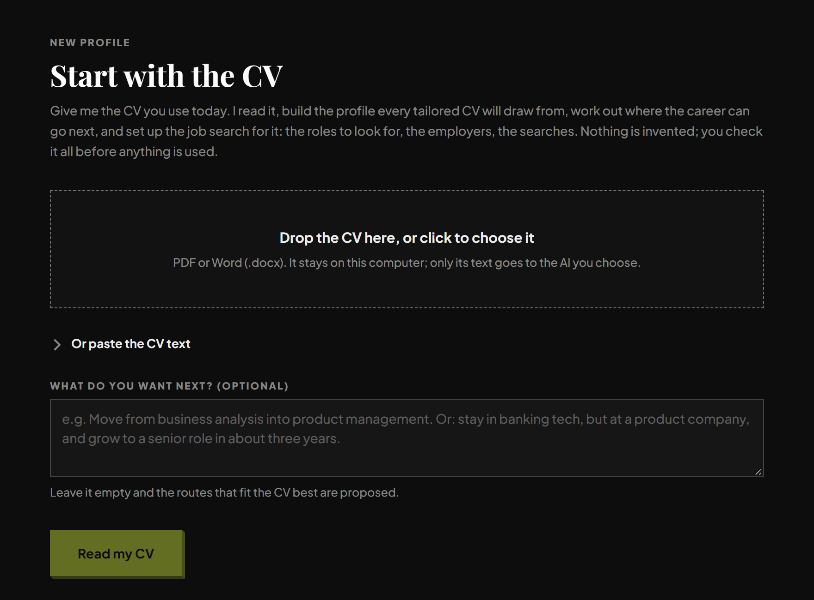</p>

Then you check every line it read, and see how it reads your career: your level, the ladder ahead, and the roles it will
look for. Anything it couldn't back up from the CV is flagged.

<p align="center">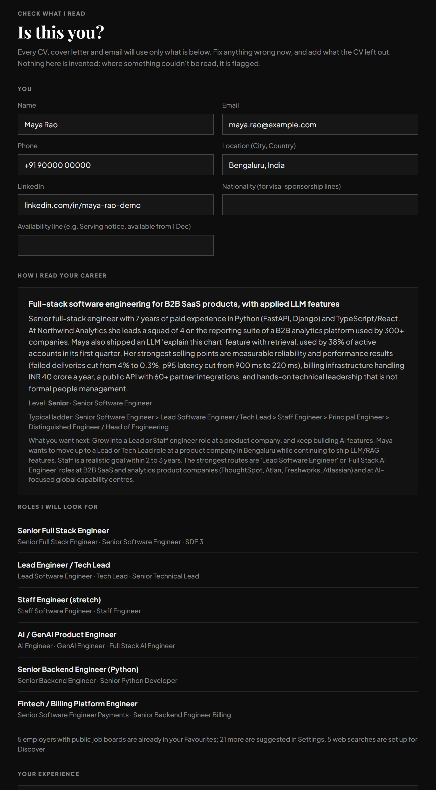</p>

### 2. Tailor: one paste, one CV built for the job

Paste a job link (or the whole description) and press Enter. Job boards like Greenhouse, Lever, Ashby, Workable,
SmartRecruiters, Recruitee and Personio are read through their public APIs in about a second.

<p align="center">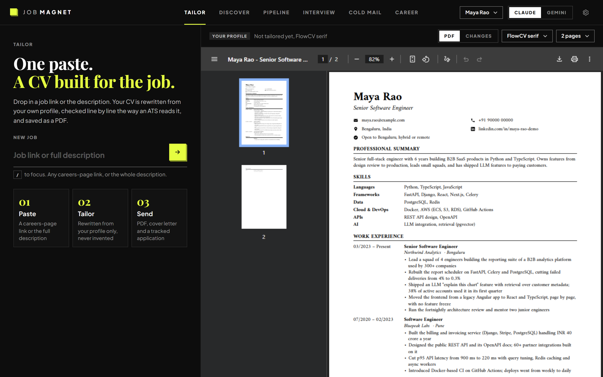</p>

In 1 to 3 minutes you get the tailored PDF, with the **keyword match** it reaches, your match **before** tailoring, and
the **ceiling** your profile can truthfully reach. If the ceiling is low, the job asks for a lot you don't have, and
it tells you so before you spend an evening on it.

**See every change.** Switch to *Changes* to see what was rewritten, merged, or written new for this job. Hover a
highlighted line to see your original.

<p align="center">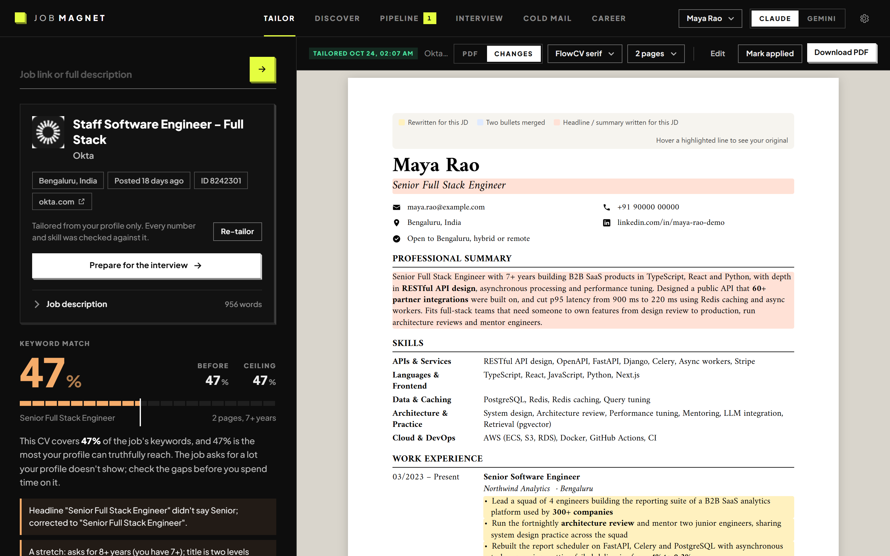</p>

**Everything around the CV**, in tabs next to it:

<table>
<tr>
<td width="50%"><b>Keywords and gaps.</b> Green is in your CV, red is required and missing, struck through is not in your profile. Tick a gap that's true and it joins your profile.<br><br>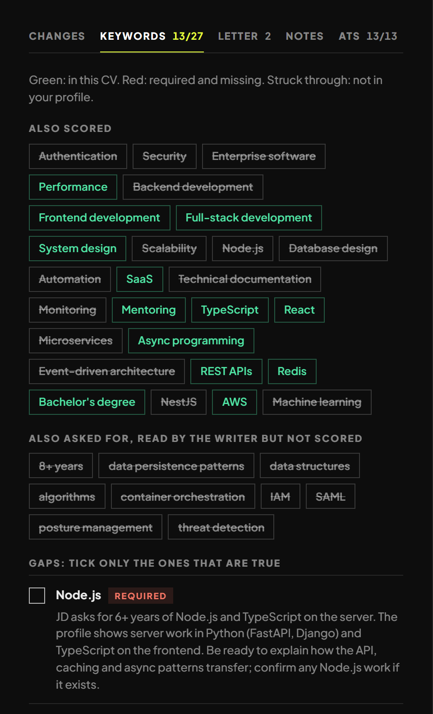</td>
<td width="50%"><b>ATS read-back.</b> The finished PDF is parsed the way an ATS parses it: text layer, contact details, headings, reading order, fonts, size.<br><br>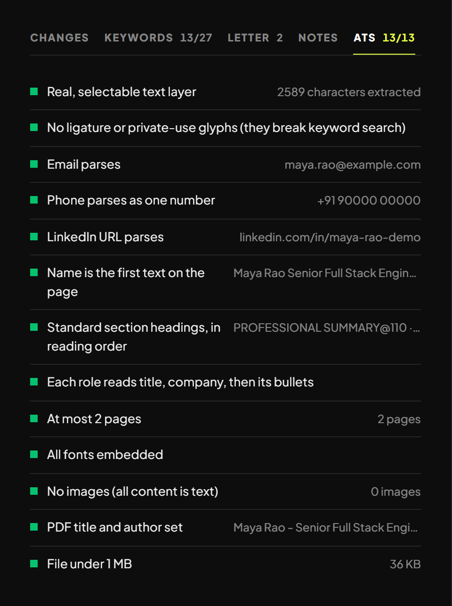</td>
</tr>
<tr>
<td><b>Cover letters in five voices.</b> Plainspoken, Storyteller, Formal, Warm and Proof points. Every version is kept; <b>Use this</b> picks the one that goes with the PDF. Export as PDF, DOCX or DOC.<br><br>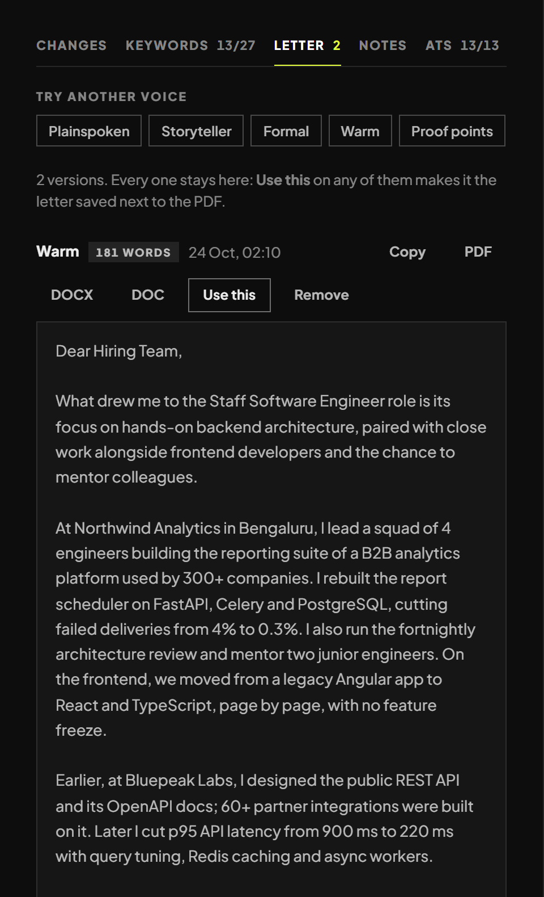</td>
<td><b>What a recruiter will notice</b>, including the biggest risk in your application, and a 300-character note to the recruiter, ready to paste.<br><br>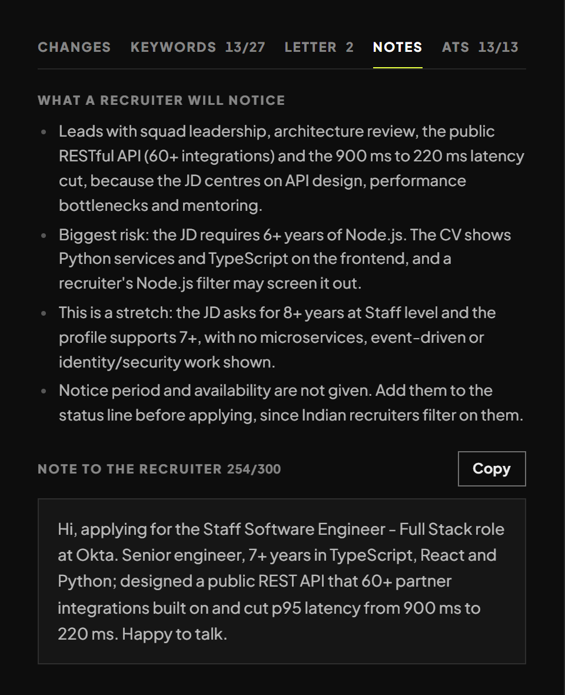</td>
</tr>
</table>

More in Tailor:

- **Four designs** (FlowCV serif, Engineer, Modern sans, Classic) and **1 or 2 pages**, re-rendered in seconds with no AI run.
- **Edit any section by hand** next to the live PDF. The same checks run on your edits.
- **Market conventions** for India, UK, EU, UAE, Singapore, Australia/NZ, US/Canada and Remote: header line, page length, spelling.
- **One-click download** as `Company_Position_Your_Name.pdf`, then **Mark applied**.

### 3. Discover: fresh jobs, ranked for you

Discover scans the job boards of your favourite employers and your saved web searches, keeps only fresh postings, and
ranks them by how much of each job your profile can truthfully cover. Jobs at your level come first.

<p align="center">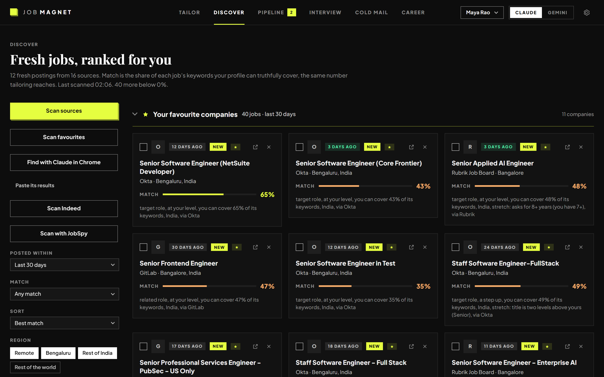</p>

**Not for me.** Press **×** on a job you don't want and say what's off: role, level, company, place or tech stack. Once
two or more passes agree, Discover pushes similar jobs down; after four it hides them. Jobs you tailor count the other
way. Every rule it learns is listed under **Learned from you**, where one click takes it back.

<table>
<tr>
<td width="55%">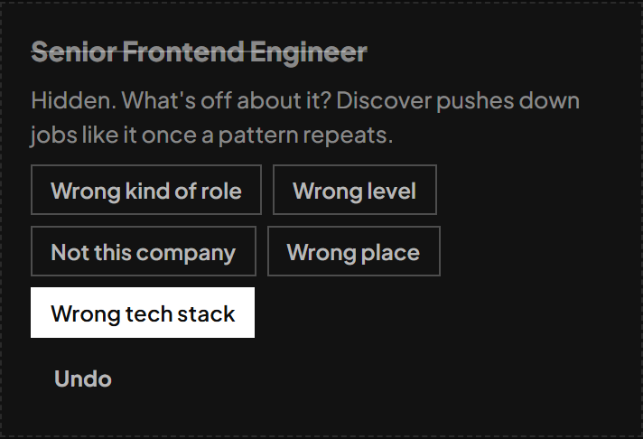</td>
<td width="45%">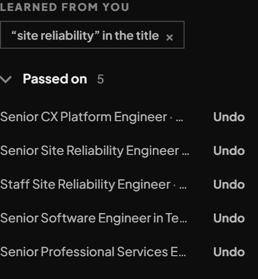</td>
</tr>
</table>

More in Discover:

- **Favourite companies**: add one by name and JobMagnet finds its job board; their jobs are pinned at the top.
- **Filters**: posted within (24 hours to 30 days), minimum match, region (your city, rest of country, remote, abroad), neighbourhoods, skills to skip.
- **Tick several jobs and tailor them all** in the background.
- **Scan Indeed** through Indeed's own Claude connector, and **Find with Claude in Chrome** for sites only your signed-in browser can read.

### 4. Pipeline: every application in one place

<p align="center">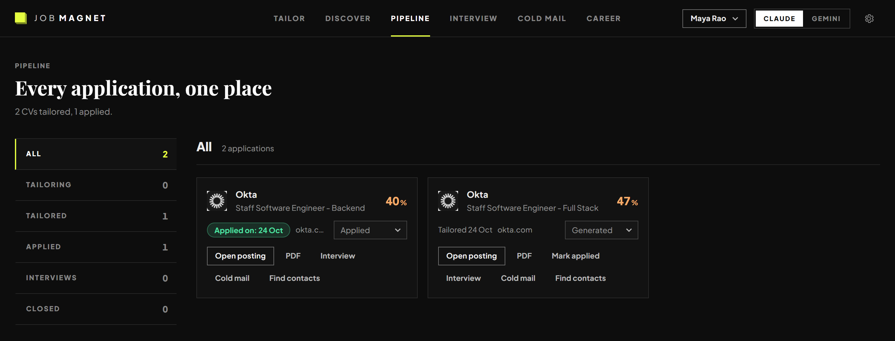</p>

Stages from Tailoring to Closed, with counts. Change status on the card, open the posting or the PDF, start interview
prep or a cold email, find contacts, or **export everything to Excel**.

### 5. Interview: walk in knowing the questions

<p align="center">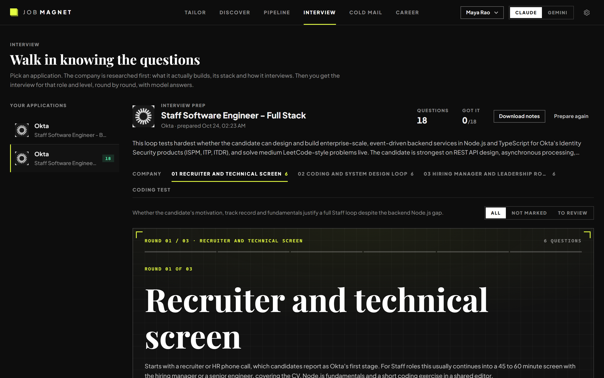</p>

- **Company research first**, with sources: what it builds, its stack, its values, and how it interviews for this role.
- **Three rounds planned like the real thing**: a screen, the deep round, and a leadership and culture round built on the company's own values.
- **Model answers from your real experience**, in the first person, honest about gaps.
- **Adaptive practice**, one question at a time, harder as you get them right.
- **An adaptive coding test** for coding roles: ten problems in Python or JavaScript, run in a sandbox in your browser.

### 6. Cold mail: get a reply, not a silence

<p align="center">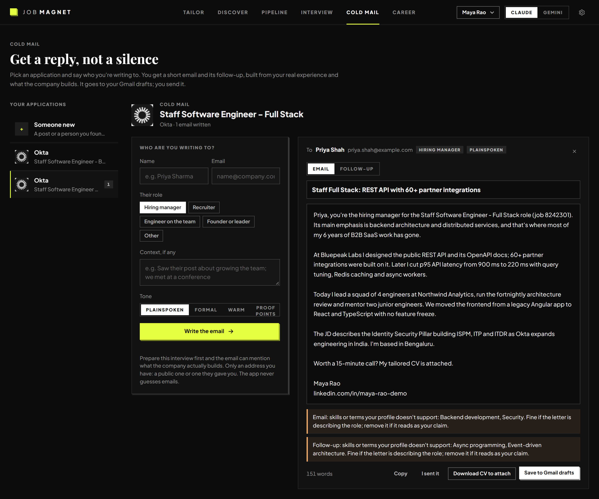</p>

A short email (90 to 150 words) and its follow-up, built from your tailored CV and what the company actually does. The
same checks as your CV flag anything your profile doesn't support. **Save to Gmail drafts** puts it in your Gmail; you
attach the CV and send it yourself.

### 7. Career: where your next five years can go

<p align="center">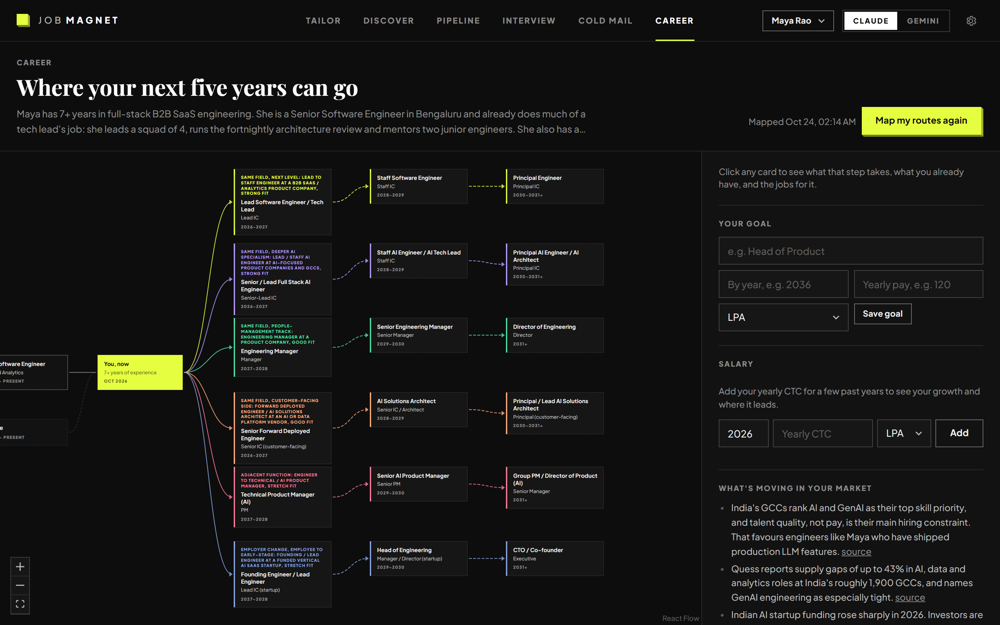</p>

Your history as a map, and five or six researched routes for the next five years. Every step says what employers screen
for, what you already have, what to build, and the pay range with its source. Set a goal, log your salary, and keep a
growth log the next map reads.

### 8. Chrome extension: apply from the job page

- 🪟 **A side panel that stays open** while you move from the posting to the form. Click the toolbar icon or press **Alt+Shift+J**.
- 📖 **Reads the page you're on**, including LinkedIn, Indeed and Naukri. It only reads what you already have open, so you're doing nothing a copy and paste wouldn't. Select the description first if the page shows several jobs.
- ✂️ **Tailor my CV** from the page, with the numbers in the panel: keyword match before, now and ceiling, ATS checks passed, and anything to check.
- 📝 **Fills the application form**: text, dropdowns, radio buttons, checkboxes and comboboxes, from your profile, the tailored CV and the JD. It **attaches the CV and cover letter PDFs**. Equal-opportunity questions get "decline to answer".
- 🙋 **Never guesses the personal ones.** Visa, salary, notice period and the like are left for you, outlined in orange. Answer once and every later form fills them.
- ✅ **You press Submit.** The panel shows exactly which button it will press. Once the page confirms, the application moves to Applied in Pipeline.

### 9. Settings and profiles

<p align="center">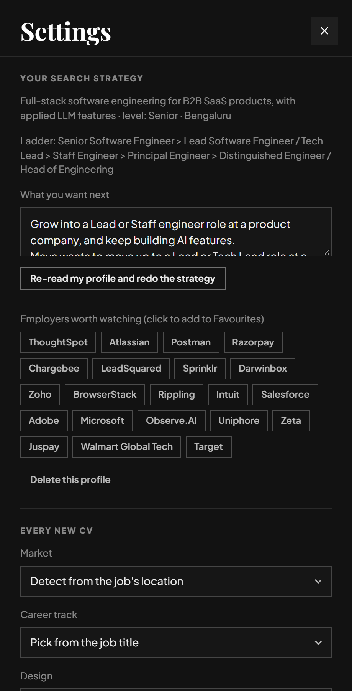</p>

- **Your strategy**, editable, with **Re-read my profile and redo the strategy** after your CV or goal changes.
- **Employers worth watching**, one click to add to Favourites.
- **Defaults for every new CV**: market, career track, design, length, writer, and how many jobs tailor at once.
- **Several profiles on one install**, each with its own CV, applications and scans. Switch from the top bar.

---

## 🛡️ What it will never do

- **Invent anything.** Titles, companies and dates are printed by code. Every number and skill in generated text is checked against your profile.
- **Overstate your level.** The career track changes what your CV leads with, never what it claims.
- **Send or submit anything for you.** Emails become drafts. Forms are filled for you to review, and you press Submit.
- **Mention a weakness in a cover letter.** Gaps are for your interview prep.
- **Upload your data anywhere** except the brief sent to the writer you chose.

---

## 🔎 Where jobs come from

| Source | How |
|---|---|
| Greenhouse, Lever, Ashby, SmartRecruiters, Workable, Recruitee, Personio | Their public job-board APIs |
| Any other careers page | schema.org job data in the page, else the page read by the AI, with every link checked to be real. `robots.txt` is respected. |
| Web searches you save | Claude's web search |
| Indeed | Indeed's official Claude connector (needs a claude.ai sign-in) |
| Claude in Chrome, the Chrome extension | Your own signed-in browser reads pages you open yourself |
| **Scan with JobSpy** (optional) | The open-source [JobSpy](https://github.com/speedyapply/JobSpy) library scrapes LinkedIn, Indeed, Google Jobs and Naukri. **Their terms of service don't allow scraping**, and they may block it. It's a separate button, never part of a normal scan. Use it at your own risk. |

Sites whose terms forbid automated access (LinkedIn, Naukri, Glassdoor and others) are refused as scan sources.

---

## 🧰 Troubleshooting

| You see | Do this |
|---|---|
| *The claude CLI is not on PATH* | Install Claude Code (above), open a **new** terminal, and start the app from it. |
| *Gemini CLI is not installed* | `npm install -g @google/gemini-cli`, then restart the app. |
| *Gemini CLI is not signed in* or *IneligibleTierError* | Use a Gemini API key: [Option 2A](#option-2-gemini). |
| The PDF step fails or *ERR_FILE_NOT_FOUND* | Install Google Chrome. On Windows, keep JobMagnet in a short folder such as `C:\jobmagnet`. |
| `start.bat` says setup failed | Install Python 3.12 with *Add to PATH* ticked, delete the `.venv` folder, and run `start.bat` again. |
| Port 8765 is already in use | JobMagnet is already running: open http://127.0.0.1:8765. |
| Scan Indeed or Gmail drafts fail | Sign in to Claude with a subscription and turn on the connector at claude.ai → Settings → Connectors. |
| The extension says it can't reach the app | Start JobMagnet first; the extension only talks to http://127.0.0.1:8765. |

Still stuck? [Open a bug report](https://github.com/pixar634/jobmagnet/issues/new/choose), without personal details.

---

## 📁 Project layout

| Path | What |
|---|---|
| `app/main.py` | The FastAPI server: every page and API route |
| `app/tailor.py`, `app/render.py`, `app/atscheck.py` | Writing the CV, the checks on it, printing the PDF and reading it back |
| `app/onboarding.py`, `app/profiles.py`, `app/strategy.py` | Reading a CV into a profile; several profiles on one install; the strategy that drives every screen |
| `app/discover.py`, `app/taste.py` | Job sources, ranking, and what Discover learns from *Not for me* |
| `app/letters.py`, `app/coldmail.py`, `app/contacts.py` | Cover letters, cold emails, finding contacts |
| `app/interview.py`, `app/static/runner.js` | Interview prep and the coding-test sandbox |
| `app/career.py` | The career map |
| `app/apply.py` | Answers for an application form: profile facts by code, the rest by the model, saved answers reused |
| `app/engines.py` | Running Claude Code and the Gemini CLI |
| `app/static/` | The web UI: plain JavaScript and CSS, no build step. The design system runs `tokens.css` → `base.css` → `components.css` → `views.css` |
| `extension/` | The Chrome extension: `panel.js` is the side panel, `page.js` reads and fills the page |
| `knowledge/` | Writing rules, market conventions, the cover-letter voices and the skills taxonomy |
| `tests/` | The test suite (`pytest`) |
| `data/`, `profiles/`, `output/` *(local only, never committed)* | Your profiles, applications and scans |

---

## 🤝 Contributing

Contributions are welcome, including your first one. Read [CONTRIBUTING.md](CONTRIBUTING.md) for setup, the rules that
keep JobMagnet trustworthy, and how pull requests are named and merged. Then pick an issue labelled
[`good first issue`](https://github.com/pixar634/jobmagnet/issues?q=is%3Aopen+label%3A%22good+first+issue%22).

Questions and ideas go in [Discussions](https://github.com/pixar634/jobmagnet/discussions). Everyone follows the
[Code of Conduct](CODE_OF_CONDUCT.md).

## 🔒 Security

Please report security problems privately, as described in [SECURITY.md](SECURITY.md). Don't open a public issue.

## 📄 License

JobMagnet is [MIT licensed](LICENSE). It bundles third-party libraries and fonts under their own licenses: see
[THIRD_PARTY_NOTICES.md](THIRD_PARTY_NOTICES.md).
